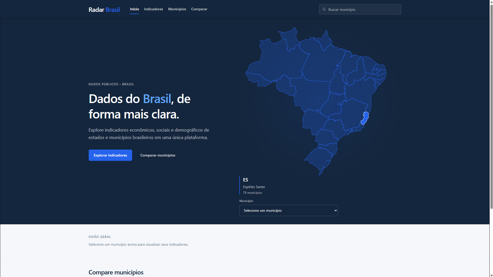
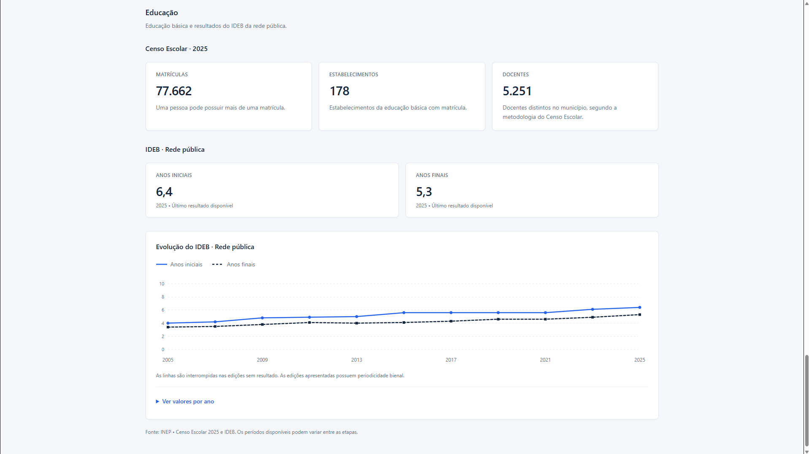

# Radar Brasil

Plataforma full stack para explorar e comparar indicadores municipais brasileiros com dados públicos oficiais.

**React • TypeScript • Laravel • PostgreSQL • Docker • Tailwind CSS**



O Radar Brasil reúne dados de diferentes fontes públicas em uma única aplicação. Os dados são importados e armazenados pelo backend em Laravel e disponibilizados ao frontend React por uma API REST.

O projeto foi desenvolvido com foco em desenvolvimento full stack, integração com dados públicos e visualização de indicadores municipais.

## Visão do projeto

- Mapa interativo das UFs para selecionar estados e explorar seus municípios.
- Busca de municípios com filtro por UF e paginação.
- Perfil municipal com economia, trabalho e empresas, demografia, condições de vida e educação.
- Catálogo com 26 indicadores organizados por tema.
- Comparação entre dois municípios.
- Histórico dos indicadores quando disponível.
- Gráficos de PIB, IDEB e distribuição por idade e sexo.
- Interface responsiva e navegação por teclado.



*Perfil de Vitória (ES): indicadores educacionais e evolução do IDEB.*

## Destaques técnicos

- Pipeline próprio para importação de dados do IBGE e INEP.
- API REST desenvolvida em Laravel.
- Persistência dos dados em PostgreSQL.
- Sincronizações reexecutáveis sem duplicação dos registros.
- Validação dos dados antes da persistência.
- 26 indicadores distribuídos em cinco temas.
- Testes automatizados no frontend e backend.

## Dados e pipeline

Os dados utilizados pela aplicação são armazenados no PostgreSQL. Dessa forma, o frontend consulta a API do próprio projeto e não depende de chamadas ao IBGE ou INEP durante a navegação.

As sincronizações validam códigos municipais, unidades e períodos antes de salvar os dados. As cargas podem ser executadas novamente sem duplicar os registros.

| Fonte | Uso no projeto |
| --- | --- |
| IBGE — Localidades e Malhas | Estados, municípios e geometria das UFs 
| IBGE — Censo Demográfico | População, área, densidade, demografia e condições de vida 
| IBGE — PIB dos Municípios | PIB, PIB per capita e valores adicionados por setor 
| IBGE — CEMPRE | Unidades locais, organizações, pessoal ocupado e salário médio 
| INEP — Censo Escolar e IDEB | Matrículas, estabelecimentos, docentes e IDEB 

## Stack e arquitetura

| Camada | Tecnologias |
| --- | --- |
| Frontend | React, TypeScript, Vite, Tailwind CSS, React Router e D3 Geo |
| Backend | PHP 8.4, Laravel 13, Eloquent e API REST |
| Banco de dados | PostgreSQL 17 |
| Ambiente local | Docker e Docker Compose |

Fluxo principal da aplicação:

```text
Fontes públicas
      ↓
Sincronizadores Laravel
      ↓
PostgreSQL
      ↓
API REST
      ↓
React
```

No backend, controllers expõem os dados pela API e serviços e comandos cuidam das importações.

No frontend, serviços fazem a comunicação HTTP, hooks controlam os estados das requisições e os componentes apresentam os indicadores.

## Rodando o projeto localmente

### Pré-requisitos

- Git
- Docker e Docker Compose
- Node.js 24 e npm
- Internet para instalar as dependências e realizar as cargas de dados

PHP e Composer não precisam estar instalados no computador. Eles são executados dentro do container do backend.

### 1. Configurar o ambiente

Clone o repositório e entre na pasta do projeto.

Em uma instalação nova, crie os arquivos de ambiente:

```sh
cp .env.example .env
cp backend/.env.example backend/.env
cp frontend/.env.example frontend/.env.local
```

Escolha uma senha local e preencha `POSTGRES_PASSWORD` no `.env` da raiz e `DB_PASSWORD` no `backend/.env` com o mesmo valor. O Compose exige `POSTGRES_PASSWORD` preenchido.

Se já houver um volume PostgreSQL em uso, mantenha o `backend/.env` existente e reutilize sua senha no `.env` da raiz. A variável de inicialização do contêiner não altera a senha de um volume já inicializado. Use os passos de inicialização abaixo apenas em uma instalação nova.

O restante da configuração do backend para o PostgreSQL do Docker é:

```dotenv
APP_ENV=local
APP_DEBUG=true
APP_URL=http://localhost:8000

DB_CONNECTION=pgsql
DB_HOST=database
DB_PORT=5432
DB_DATABASE=radar_brasil
DB_USERNAME=radar
DB_PASSWORD=
```

No frontend:

```dotenv
VITE_API_URL=http://localhost:8000
```

Não adicione `/api` ao final de `VITE_API_URL`.

`APP_DEBUG=true` deve ser utilizado apenas no desenvolvimento local. Em ambientes expostos, utilize `APP_DEBUG=false`.

### 2. Preparar backend e banco de dados

Na raiz do projeto:

```sh
docker compose config --quiet
docker compose build backend
docker compose run --rm backend composer install
docker compose run --rm backend php artisan key:generate
docker compose up -d database
docker compose exec -T database pg_isready -U radar -d radar_brasil
```

Quando o PostgreSQL estiver aceitando conexões:

```sh
docker compose up -d backend
docker compose exec -T backend php artisan migrate
docker compose exec -T backend php artisan db:seed
```

O `DatabaseSeeder` prepara as 27 UFs utilizando o `StateSeeder`. O processo pode ser executado novamente sem duplicar os estados.

### 3. Carregar os dados

Depois das migrations e do seeder, execute os comandos abaixo na ordem apresentada:

```sh
docker compose exec -T backend php artisan municipalities:sync

docker compose exec -T backend php artisan indicators:sync-census

docker compose exec -T backend php artisan indicators:sync-economy

docker compose exec -T backend php artisan indicators:sync-demography

docker compose exec -T backend php artisan municipalities:sync-age-distribution

docker compose exec -T backend php artisan indicators:sync-school-census --year=2025

docker compose exec -T backend php artisan indicators:sync-ideb --edition=2025 --network=public

docker compose exec -T backend php artisan indicators:sync-cempre
```

Cada comando possui uma responsabilidade:

| Comando | Dados |
| --- | --- |
| `municipalities:sync` | Municípios e associação com as UFs |
| `indicators:sync-census` | População, área e densidade |
| `indicators:sync-economy` | PIB, PIB per capita e VAB por setor |
| `indicators:sync-demography` | Demografia e condições de vida |
| `municipalities:sync-age-distribution` | Distribuição por idade e sexo |
| `indicators:sync-school-census --year=2025` | Matrículas, estabelecimentos e docentes |
| `indicators:sync-ideb --edition=2025 --network=public` | Histórico municipal do IDEB |
| `indicators:sync-cempre` | Indicadores de trabalho e empresas |

As cargas dependem da disponibilidade das fontes oficiais e podem levar alguns minutos.

Em algumas execuções, a fonte oficial do INEP apresentou problema na cadeia TLS. O procedimento utilizado para diagnóstico está documentado em [Educação](backend/docs/education.md). A verificação TLS não deve ser desativada.

### 4. Iniciar o frontend

Em outro terminal:

```sh
cd frontend
npm ci
npm run dev
```

A aplicação ficará disponível em:

- Frontend: `http://localhost:5173`
- Backend/API: `http://localhost:8000`

Exemplo de endpoint:

```text
http://localhost:8000/api/states/32/municipalities
```

Depois da primeira configuração, não é necessário repetir migrations ou cargas de dados sempre que iniciar o projeto.

Para utilizar novamente:

```sh
docker compose up -d
```

E no frontend:

```sh
npm run dev
```

Os dados do PostgreSQL permanecem no volume `postgres_data`.

## Testes e verificações

### Frontend

Dentro de `frontend`:

```sh
npm test
npm run lint
npm run build
```

### Backend

Na raiz do projeto:

```sh
docker compose exec -T backend vendor/bin/phpunit
docker compose exec -T backend vendor/bin/pint --test
docker compose exec -T backend composer validate --no-check-publish
docker compose exec -T backend composer audit
```

Os testes do backend utilizam SQLite em memória e não alteram o banco PostgreSQL usado pela aplicação.

## Documentação técnica

A documentação das principais integrações está separada por área:

- [Indicadores, Censo e Economia](backend/docs/indicators.md)
- [Demografia e condições de vida](backend/docs/demography.md)
- [Educação e INEP](backend/docs/education.md)
- [Trabalho e empresas — CEMPRE](backend/docs/cempre.md)
- [Geometria das UFs](frontend/src/assets/geography/README.md)

## Escopo e limitações

- O projeto foi desenvolvido para execução local.
- A disponibilidade dos dados depende das fontes oficiais.
- Nem todos os indicadores possuem dados para todos os municípios e períodos.
- As referências temporais variam de acordo com o indicador.
- A comparação entre municípios atualmente utiliza 21 indicadores. Os cinco indicadores do CEMPRE estão disponíveis no perfil municipal e no catálogo de indicadores.
- As fontes oficiais podem revisar seus arquivos e valores ao longo do tempo.